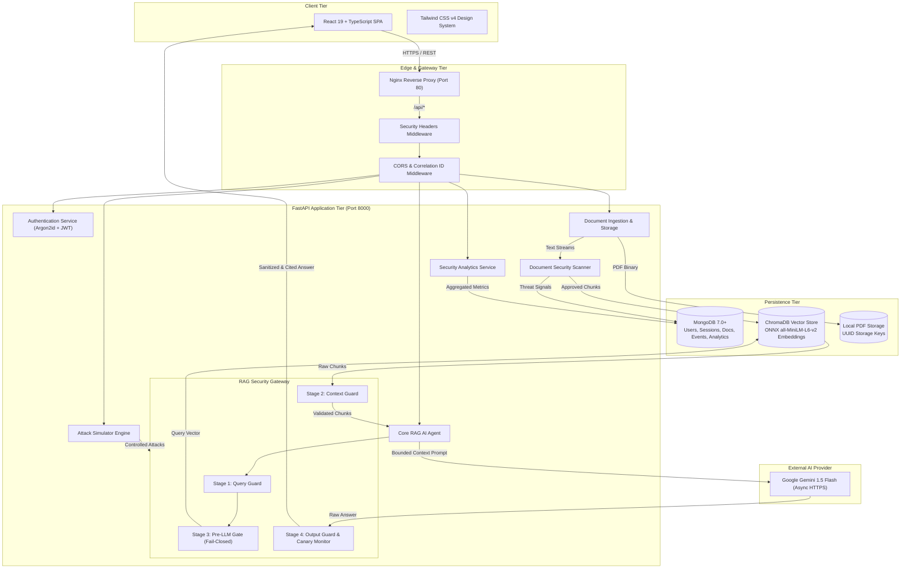

# SentinelRAG — Secure Retrieval-Augmented Generation Agent

[](#18-license)
[](https://www.python.org/downloads/)
[](https://fastapi.tiangolo.com)
[](https://react.dev/)
[](https://tailwindcss.com/)
[](#13-testing)
[](#12-security-architecture)

> **Intelligence. Protected.**  
> A production-conscious, multi-tenant Document Intelligence platform and AI agent engineered with defense-in-depth security controls, untrusted context boundaries, an active canary leakage detector, and a dedicated Attack Simulator Lab to evaluate prompt injection and RAG vulnerabilities.

---

## 1. Project Overview

Retrieval-Augmented Generation (RAG) applications have emerged as the primary pattern for connecting Large Language Models (LLMs) with enterprise knowledge bases. However, standard RAG architectures suffer from critical security blind spots:
1. **Indirect Prompt Injection:** Adversarial instructions hidden inside uploaded documents are treated as trusted context by the LLM.
2. **System Prompt & Data Exfiltration:** Attackers manipulate queries to leak developer instructions, API credentials, or private document data.
3. **Cross-Tenant Vector Bleed:** Weak metadata filtering in vector databases allows users to retrieve document chunks belonging to other tenants.
4. **Unverified Claims:** Many security tools rely on probabilistic claims rather than deterministic adversarial testing.

**SentinelRAG** solves these challenges by enveloping the retrieval pipeline in a multi-stage **RAG Security Gateway**, establishing strict untrusted context boundaries, and validating defense effectiveness through an integrated **Attack Simulator Lab** and **Security Center**.

---

## 2. Key Features

- **Secure PDF Ingestion & Validation:** Validates MIME types, verifies file signatures (magic bytes `%PDF-`), rejects encrypted or corrupted files gracefully, enforces streaming upload limits, and stores files safely outside the web root.
- **Deterministic Document Security Screening:** Inspects incoming documents for prompt injection patterns, role-assumption hijacking, anti-evasion obfuscation (zero-width characters, leetspeak, spacing evasion), and data exfiltration payloads before chunking.
- **Review Queue & Vector Isolation:** Holds suspicious documents in a quarantined review queue; vector indexing is completely blocked until explicit approval, and quarantined document vectors are automatically purged.
- **Multi-Tenant Vector Isolation:** Semantic search over ChromaDB ONNX embeddings enforces strict metadata filtering combined with backend identity verification and live MongoDB document lifecycle checks.
- **RAG Security Gateway (Fail-Closed):**
  - *Query Guard:* Blocks direct prompt injections, jailbreaks, and credential harvesting attempts.
  - *Context Guard:* Inspects retrieved chunks, automatically dropping cross-tenant chunks and raising critical audit events.
  - *Pre-LLM Gate:* Halts execution immediately if query or context violations occur; the LLM provider is **never** invoked on blocked requests.
  - *Output Guard:* Redacts sensitive API keys and monitors for active canary token leakage before responses leave the server.
- **Canary Leakage Protection:** Synthesizes isolated canary secrets to detect LLM prompt-leakage or out-of-band context exfiltration in real time.
- **Attack Simulator Lab:** Built-in security testing range with 18 automated adversarial scenarios across 8 threat categories to stress-test the gateway and compute accurate block rates.
- **Security Center & Analytics:** Real-time dashboards visualizing KPIs, hourly/daily activity timelines (24h/7d/30d/90d), threat distributions, and paginated audit event logs.
- **Enterprise-Grade Identity & Access:** Argon2id password hashing, signed JWT HS256 tokens, automatic refresh-token rotation, and token-reuse detection.

---

## 3. System Architecture



---

## 4. Technology Stack

| Domain | Technology | Version | Purpose |
|---|---|---|---|
| **Frontend Framework** | React | 19.3.1 | Single-Page Application user interface |
| **Language & Typing** | TypeScript | ~7.0.2 | End-to-end type safety |
| **Styling & Theme** | Tailwind CSS | 4.3.5 | Security-themed cybersecurity design system |
| **Routing** | React Router | 7.18.5 | Client-side SPA navigation |
| **Build Tool** | Vite | 8.3.6 | Frontend development and bundling |
| **Backend API** | FastAPI | 0.115+ | High-performance asynchronous REST API |
| **Runtime** | Python | 3.12 | Backend application runtime |
| **Document Processing** | PyMuPDF | 1.24+ | Fast, robust page-by-page PDF extraction |
| **Primary Database** | MongoDB | 7.0+ | User records, document metadata, security events |
| **Vector Store** | ChromaDB | 1.0.9 | Local ONNX all-MiniLM-L6-v2 vector embeddings |
| **LLM Provider** | Google Gemini API | 1.5 Flash | Fast, grounded reasoning model via async HTTP |
| **Cryptography** | Argon2id & PyJWT | 23.1 / 2.8 | Enterprise password hashing and JWT issuance |
| **Containerization** | Docker & Compose | 24.0+ / v2.20+ | Multi-container production deployment |
| **Testing** | Pytest & pytest-asyncio| 8.4 / 0.24 | Automated backend testing suite |

---

## 5. Project Directory Structure

```text
SentinelRAG/
├── .github/
│   └── workflows/
│       └── ci.yml                   # Automated CI verification workflow
├── backend/
│   ├── app/
│   │   ├── api/
│   │   │   ├── dependencies.py       # JWT verification and user resolution
│   │   │   └── routes/               # Modular API endpoint routers
│   │   │       ├── auth.py           # User registration, login, token refresh
│   │   │       ├── chat.py           # RAG conversations and question answering
│   │   │       ├── documents.py      # PDF upload, review queue, purge
│   │   │       ├── health.py         # Liveness & dependency health probes
│   │   │       ├── security_analytics.py # Overview, timeline, event explorer
│   │   │       └── simulator.py      # Adversarial scenario execution & stats
│   │   ├── core/
│   │   │   ├── config.py             # Pydantic Settings environment configuration
│   │   │   ├── logging.py            # Structured logging & secret redaction
│   │   │   └── security.py           # Argon2id hashing and JWT encoding/decoding
│   │   ├── db/
│   │   │   ├── mongodb.py            # Motor async MongoDB client & connection
│   │   │   ├── chromadb.py           # ChromaDB persistent collection manager
│   │   │   └── *_repo.py             # Repository layer for data entities
│   │   ├── models/                   # Pydantic internal database models
│   │   ├── schemas/                  # Request and response API envelopes
│   │   ├── services/                 # Business logic and security services
│   │   │   ├── attack_scenarios.py   # Catalog of 18 adversarial scenarios
│   │   │   ├── canary_service.py     # Secret canary synthesis and tracking
│   │   │   ├── chunking_service.py   # Sliding-window document chunker
│   │   │   ├── document_service.py   # Lifecycle management & review workflows
│   │   │   ├── indexing_service.py   # ChromaDB vector embedding & ingestion
│   │   │   ├── llm_provider.py       # Async Gemini 1.5 Flash client
│   │   │   ├── output_security_service.py # Sanitization & canary inspection
│   │   │   ├── pdf_service.py        # PyMuPDF text extraction & bounds checking
│   │   │   ├── query_security_service.py  # Prompt injection & jailbreak detection
│   │   │   ├── rag_service.py        # End-to-end RAG question answering pipeline
│   │   │   ├── retrieval_service.py  # Authorized vector search & document validation
│   │   │   ├── security_gateway.py   # Multi-stage security gateway coordinator
│   │   │   ├── security_scanner.py   # Document security & injection scanner
│   │   │   ├── simulation_service.py # Attack simulation execution engine
│   │   │   └── storage_service.py    # Disk file storage & path traversal guard
│   │   ├── utils/
│   │   │   ├── correlation.py        # X-Correlation-ID request tracing middleware
│   │   │   └── security_headers.py   # Defense-in-depth HTTP security headers
│   │   └── main.py                   # FastAPI application factory & lifespan
│   ├── tests/                        # 9 test suites (80 automated test cases)
│   ├── Dockerfile                    # Production backend container definition
│   └── requirements.txt              # Pinned Python dependencies
├── docs/                             # Architecture & specifications
│   ├── 01_PRD.md                     # Product Requirements Document
│   ├── 02_SRS.md                     # Software Requirements Specification
│   ├── 03_SYSTEM_ARCHITECTURE.md     # System Architecture & Flow
│   ├── 04_SECURITY_SPECIFICATION.md  # Threat Model & Security Controls
│   ├── 05_DATABASE_SPECIFICATION.md  # MongoDB & ChromaDB Data Models
│   ├── 06_TESTING_STRATEGY.md        # Comprehensive Quality Assurance
│   ├── 07_DESIGN_SYSTEM.md           # UI Design Language & Components
│   ├── 08_SECURITY_AUDIT_REPORT.md   # Phase 9 Comprehensive Security Audit
│   └── 09_DEPLOYMENT_GUIDE.md        # Complete DevOps & Production Runbook
├── frontend/
│   ├── src/
│   │   ├── components/               # Reusable UI components (Modals, Cards, Sidebar)
│   │   ├── context/                  # AuthContext and state management
│   │   ├── pages/                    # Route pages (Auth, Documents, Chat, Lab, Analytics)
│   │   ├── services/                 # Centralized typed API client
│   │   └── types/                    # TypeScript interfaces and API schemas
│   ├── Dockerfile                    # Multi-stage frontend container definition
│   ├── nginx.conf                    # Nginx reverse proxy and SPA router
│   ├── package.json                  # Pinned Node dependencies
│   └── vite.config.ts                # Vite build and proxy configuration
├── .dockerignore                     # Docker build exclusion rules
├── .env.example                      # Production environment template
├── docker-compose.yml                # Multi-container orchestration specification
└── PROJECT_PROGRESS.md               # Verified phase completion log
```

---

## 6. Application UI & Screenshots

The SentinelRAG user interface follows an enterprise cybersecurity visual theme featuring obsidian dark mode, crisp emerald status indicators, and dedicated threat visualizations.

| View | Description | Screenshot Placeholder |
|---|---|---|
| **Document Management & Review** | PDF upload dropzone, live security screening badges (Allowed, Review, Quarantined), risk scores, and review queue modal. | *`[Screenshot: /documents — Document Management & Ingestion]`* |
| **Protected RAG Chat Agent** | Interactive conversation interface displaying grounded answers, citations with chunk references, and inline gateway status pills. | *`[Screenshot: /chat — Protected RAG Agent Conversation]`* |
| **Attack Simulator Lab** | Adversarial range to trigger controlled prompt injections, system prompt extraction, and canary leaks, showing verdicts and latency. | *`[Screenshot: /simulator — Attack Simulator Lab Run]`* |
| **Security Center & Analytics** | Executive dashboard displaying overall metrics, time-bucketed event timelines, threat distribution bars, and filtered audit event explorer. | *`[Screenshot: /security-center — Security Analytics Dashboard]`* |

---

## 7. Installation & Local Setup

### Prerequisites
- **Python:** 3.12+
- **Node.js:** 20 LTS+
- **MongoDB:** Community Edition 7.0+ running locally on port 27017

### 1. Clone Repository & Setup Environment
```bash
git clone https://github.com/your-username/SentinelRAG.git
cd SentinelRAG

# Copy environment configuration
cp .env.example .env
```

Edit `.env` and provide:
- `JWT_SECRET`: A secure 32-byte string (generate using `openssl rand -hex 32`).
- `GEMINI_API_KEY`: Your key from [Google AI Studio](https://aistudio.google.com/).

### 2. Backend Setup
```bash
cd backend

# Create virtual environment
python -m venv .venv

# Activate virtual environment
# Windows (PowerShell):
.venv\Scripts\Activate.ps1
# Linux / macOS:
source .venv/bin/activate

# Install dependencies
pip install --upgrade pip
pip install -r requirements.txt

# Run backend development server
python -m uvicorn app.main:app --host 0.0.0.0 --port 8000 --reload
```
*Backend API will be running at [http://localhost:8000](http://localhost:8000).*

### 3. Frontend Setup
```bash
# In a new terminal window:
cd frontend

# Install dependencies
npm install

# Start Vite development server
npm run dev
```
*Frontend UI will be running at [http://localhost:5173](http://localhost:5173).*

---

## 8. Running with Docker Compose

To run the complete production-grade application stack (Frontend, Backend, and MongoDB) with containerized networking and persistent volumes:

```bash
# Ensure .env is populated in the root directory
cp .env.example .env

# Build and start all services
docker compose up -d --build

# View container logs
docker compose logs -f

# Check container health status
docker compose ps
```
*Access the application directly at [http://localhost](http://localhost).*

To shut down services:
```bash
docker compose down
```

---

## 9. API Documentation

Interactive API documentation with built-in request testing is automatically generated by FastAPI:

- **Swagger UI:** [http://localhost:8000/api/docs](http://localhost:8000/api/docs)
- **ReDoc:** [http://localhost:8000/api/redoc](http://localhost:8000/api/redoc)
- **OpenAPI Schema (JSON):** [http://localhost:8000/api/openapi.json](http://localhost:8000/api/openapi.json)

---

## 10. Security Architecture & Threat Defense

SentinelRAG implements the **OWASP Top 10 for Large Language Model Applications** using a defense-in-depth model:

1. **Pre-Retrieval Query Guard:**
   - Detects direct prompt injection attempts (`IGNORE_PREVIOUS_INSTRUCTIONS`, `ROLEPLAY_OVERRIDE`).
   - Detects system prompt extraction requests (`SYSTEM_PROMPT_EXTRACTION`).
   - Detects credential dump queries (`CREDENTIAL_HARVESTING`).
   - Normalizes obfuscated text (removing zero-width characters, normalization of Unicode homoglyphs, and space compression).
2. **Retrieval & Context Guard:**
   - Vector search enforces ChromaDB metadata filtering by authenticated `owner_id`.
   - Context Guard verifies chunk ownership against session owner, immediately dropping foreign chunks.
   - Live checks against MongoDB ensure unapproved, deleted, or quarantined documents are excluded from context.
3. **Pre-LLM Fail-Closed Gate:**
   - If any violation is flagged during query or context inspection, the request is immediately rejected.
   - **The LLM is never invoked**, preventing resource exhaustion and prompt hijacking.
4. **Post-Generation Output Guard:**
   - Scans generated responses for synthetic canary secrets. If detected, the response is blocked and a critical alert is recorded.
   - Redacts raw API keys (e.g. `AIza...`, `sk-...`, `Bearer ...`) before output delivery.
   - Strips malicious URI schemes (`javascript:`, `data:`) and HTML script tags.
5. **Multi-Tenant Data Isolation:**
   - All REST routes verify `owner_id` derived exclusively from server-validated JWT claims.
   - Cross-tenant lookups return `404 Not Found` to eliminate user and document enumeration.

> [!NOTE]  
> **Security Realism:** Prompt injection cannot be 100% eliminated on probabilistic foundation models through prompt engineering alone. SentinelRAG combines deterministic pre-filters, architectural context boundaries, canary tracking, and human review queues to form a resilient, measurable defense.

---

## 11. Automated Testing & Verification

SentinelRAG includes an exhaustive automated test suite covering all application layers:

### Running Backend Tests
```bash
# Run the complete test suite (80 test cases)
python -m pytest backend/tests/ -v
```

**Verified Test Suite Results (100% Pass Rate):**
- `test_health.py` (6 tests) — Health probes, database pings, correlation ID headers.
- `test_auth.py` (9 tests) — Registration, Argon2id verification, JWT issuance, cookie rotation.
- `test_documents.py` (5 tests) — PDF upload, magic bytes, multi-user document isolation, purge.
- `test_document_security.py` (10 tests) — Injection scanner, anti-evasion, quarantine vector purge.
- `test_security_gateway.py` (9 tests) — Fail-closed pre-LLM gate, context guard, canary leakage.
- `test_rag.py` (6 tests) — Protected RAG flow, grounded citations, empty retrieval fallbacks.
- `test_attack_simulator.py` (13 tests) — 18 scenarios across 8 categories, batch execution, verdicts.
- `test_security_analytics.py` (7 tests) — MongoDB aggregation pipelines, timelines, threat shares.
- `test_security_hardening.py` (15 tests) — Security headers, IDOR matrix, encrypted/corrupt PDFs, JWT tampering.
- **Total:** **80 passed in ~32 seconds.**

### Running Frontend Verification
```bash
cd frontend

# Run TypeScript compilation check and production bundle
npm run build
```
**Result:** Built cleanly in under 2 seconds with 0 TypeScript or bundling errors.

---

## 12. Deployment & Operations

For complete deployment architectures, cloud VPS configuration, TLS/SSL certificates via Let's Encrypt, persistent volume management, backup/restore runbooks, and disaster recovery procedures, please consult:

- **Comprehensive Deployment Runbook:** [docs/09_DEPLOYMENT_GUIDE.md](docs/09_DEPLOYMENT_GUIDE.md)
- **Phase 9 Security Audit Report:** [docs/08_SECURITY_AUDIT_REPORT.md](docs/08_SECURITY_AUDIT_REPORT.md)

---

## 13. Known Limitations

- **Image-Only & Scanned PDFs:** The current ingestion pipeline extracts embedded text layers via PyMuPDF. Scanned PDFs lacking embedded text are rejected by design (`PDFExtractionError`). OCR is omitted to avoid heavy, untrusted binary dependencies.
- **Universal Prompt Injection Complexity:** Highly novel, multi-turn linguistic manipulation may evade regex and heuristic scanners. The platform mitigates this with canary tokens, context isolation, and post-generation output inspection.
- **External API Rate Limits:** The RAG answering pipeline depends on Google Gemini API availability. Requests will fail gracefully if provider quotas are exceeded.

---

## 14. Future Improvements

- **Multimodal Document Ingestion:** Support for spreadsheet (XLSX, CSV) and document (DOCX, Markdown) ingestion.
- **Local Fallback LLM:** Integration with local Ollama or vLLM instances for air-gapped environments without external API dependencies.
- **Optical Character Recognition (OCR):** Sandboxed Tesseract/OCR engine with dedicated image preprocessing for scanned paper documents.
- **Enterprise Single Sign-On (SSO):** SAML 2.0 and OIDC integration for corporate Active Directory and Okta authentication.

---

## 15. License

No license has been specified for this project. All rights reserved.
